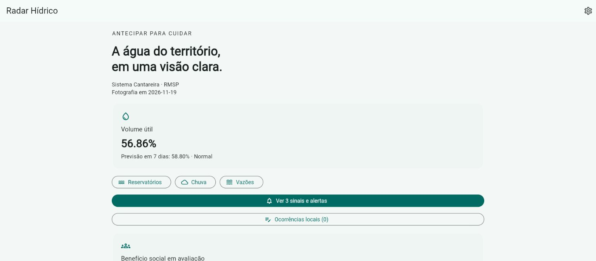
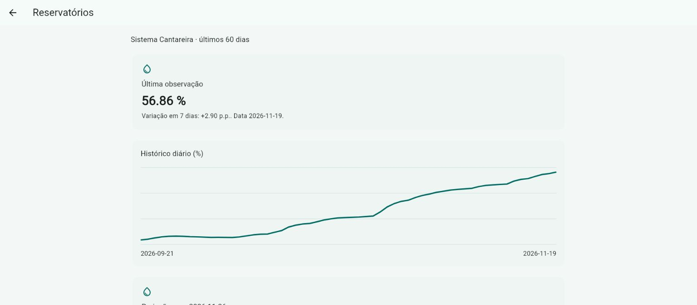
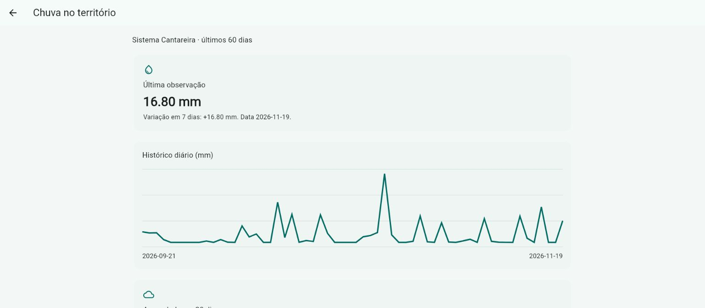
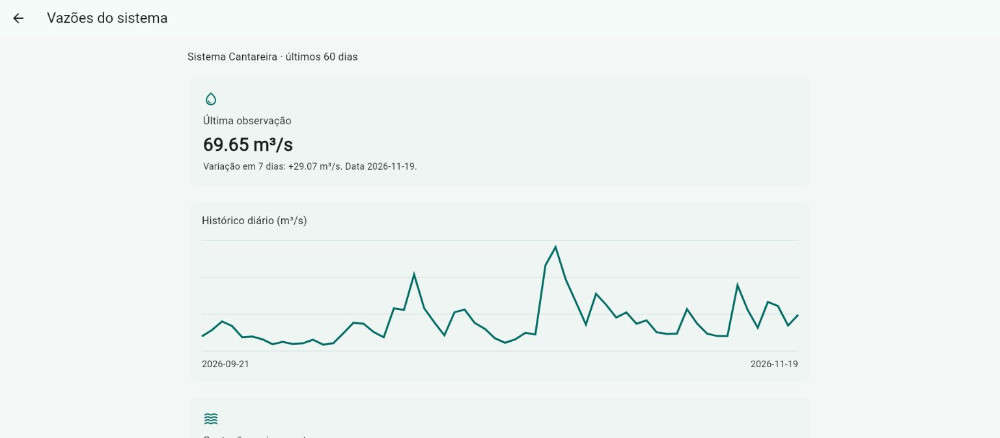
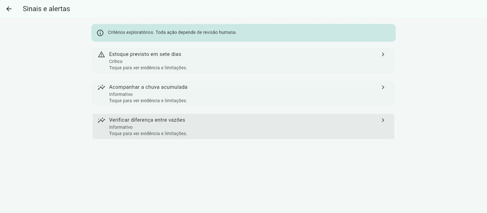
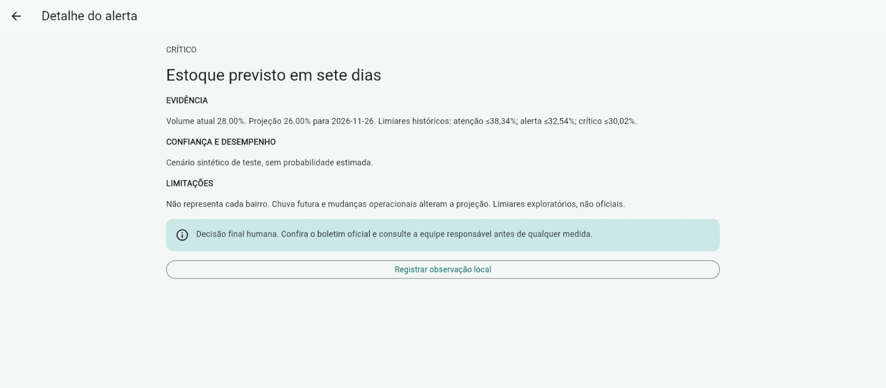
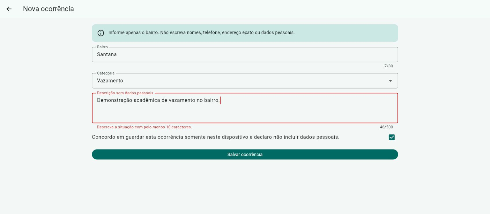
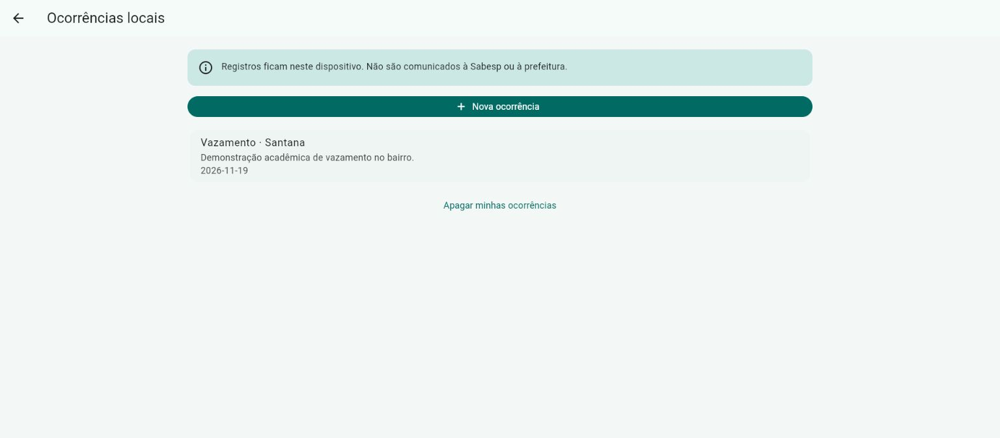
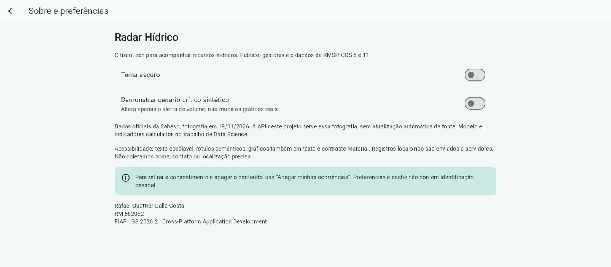

# Radar Hídrico


Dados do território para apoiar decisões humanas.

## 1. Problema e público

Reservatórios, chuva e vazões mudam em ritmos diferentes. O app reúne esses sinais do Sistema Cantareira para gestores e cidadãos da Região Metropolitana de São Paulo acompanharem tendências e organizarem a verificação humana. ODS 6 e 11. O benefício esperado é ampliar a antecedência de acompanhamento; não medimos pessoas beneficiadas nem redução real de interrupções.

## 2. Integrante

| Nome completo | RM |
|---|---|
| Rafael Quattrer Dalla Costa | 562052 |

Trabalho individual · FIAP · Turma 2CCPG.

## 3. Demonstração visual

As imagens em `assets/screenshots/` são capturas reais do aplicativo Flutter compilado e executado no Chrome. As evidências originais estão em `docs/`. Os testes de widgets verificam também as dimensões de celular e tablet.

| Início | Reservatórios | Chuva |
|---|---|---|
|  |  |  |

| Vazões | Alertas | Detalhe do alerta |
|---|---|---|
|  |  |  |

| Formulário | Ocorrências | Sobre e preferências |
|---|---|---|
|  |  |  |

## 4. Funcionalidades

- Rotas nomeadas para início, dashboard com parâmetro, lista e detalhe de alertas, ocorrências, formulário e preferências.
- Três dashboards distintos com cards, histórico de 60 dias, variação de sete dias e dados em texto.
- Alertas calculados sobre volume previsto, chuva acumulada e diferença entre vazões.
- Explicação de evidência, confiança, limitações e supervisão humana em cada sinal.
- Estado global com Provider/ChangeNotifier e estado local separado no formulário.
- API HTTP, cache persistente, fotografia inicial offline, carregamento, erro e listas vazias.
- Cadastro de ocorrência com validação, consentimento, feedback e armazenamento local.
- Tema claro/escuro persistente e cenário crítico sintético explicitamente identificado.

## 5. Dados e alertas

Fonte real: [Portal dos Mananciais da Sabesp](https://mananciais.sabesp.com.br/). A fotografia de 19/11/2026 e os últimos 60 dias estão em `assets/territorio.json`. `api.js` serve esses dados em `/api/territorio`. É uma API local sobre dados reais, sem sincronização automática com a fonte. Unidades: volume útil %, chuva mm, vazões m³/s.

O modelo Ridge do trabalho de Data Science prevê sete dias à frente. Foi selecionado na validação 2023-2024 e testado em 2025-2026, com MAE 0,65 p.p. e ganho de 44,6% sobre persistência. Volume atual 56,86%, projeção 58,80% para 26/11/2026. A faixa empírica ±1,77 p.p. cobriu 92,8% do teste; isso não é uma probabilidade garantida de previsão futura.

Limiares do histórico de treino 2017-2022: atenção ≤38,34082%; alerta ≤32,53807%; crítico ≤30,019085%. São critérios exploratórios, não faixas oficiais. O app também sinaliza chuva acumulada em 30 dias acima de 100 mm e diferença afluente menos captada positiva, como acompanhamento descritivo. O balanço é parcial, sem todas as entradas e saídas.

Nas preferências, um cenário sintético muda o volume para 28% e a projeção para 26% para demonstrar um alerta crítico. Esse cenário não altera o histórico real e não representa uma condição atual. O sinal de teste não apresenta uma probabilidade estatística.

Limitações: um sistema não representa cada bairro; revisões dos boletins, mudanças operacionais, chuva futura e dados desatualizados reduzem a confiança. O recorte pode não representar outros mananciais ou eventos inéditos. Os alertas não acionam serviços nem determinam racionamento. O indicador social exibido é um horizonte potencial de sete dias; 7/7 oportunidades de cruzamento no histórico são janelas sobrepostas e uma amostra pequena.

## 6. Privacidade e inclusão

Não são solicitados nome, telefone, localização precisa ou identificadores. O formulário pede bairro e descrição sem dados pessoais. O usuário consente antes de armazenar a ocorrência; os dados permanecem no dispositivo e podem ser apagados, retirando o consentimento. Preferências e cache persistem via SharedPreferences. Isso não é um armazenamento apropriado para segredos; o protótipo não coleta credenciais.

Tema Material 3, texto escalável, ações com tooltip/rótulo, gráfico com descrição semântica e alternativa em texto, contraste e aviso que não depende somente de cor. Os layouts foram verificados em testes de widgets nas dimensões 390 × 844 e 900 × 1000. A versão web foi executada no Chrome. Não foi verificado em dispositivo Android físico ou emulador nesta máquina.

## 7. Tecnologias e decisões

Flutter/Dart para compartilhar a interface entre mobile e web. Material UI para componentes acessíveis e tema consistente. Provider separa o estado global; controladores e consentimento do formulário ficam no estado local. `http` acessa a API com prazo de quatro segundos. SharedPreferences guarda cache, preferências e ocorrências sem dados pessoais. CustomPainter desenha os gráficos sem dependência adicional e oferece descrição semântica. Um serviço Node.js simples permite executar a API sem banco, pois não recebe dados do usuário.

Estrutura: `lib/screens` (telas), `lib/state` (estado e regras), `lib/widgets` (componentes reutilizáveis), `assets` (fotografia e evidências), `test` (regras e fluxo), `android` e `web` (plataformas).

## 8. Como executar

Use Flutter 3.50.0 / Dart 3.14 ou versões compatíveis e Node.js 20+ para a API opcional.

```sh
git clone https://github.com/RafaelQuattrer/gs-cross-radar-hidrico.git
cd gs-cross-radar-hidrico
flutter pub get
node api.js
```

Em outro terminal:

```sh
flutter run -d chrome --dart-define=API_URL=http://localhost:3001/api/territorio
```

Sem API, aguarde até quatro segundos: o cache ou a fotografia incluída permite continuar usando o app. Nenhuma chave é necessária. Para Android, use um SDK Android configurado e `flutter run -d <dispositivo>`. Em emulador Android, o host local normalmente é `10.0.2.2`; configure `API_URL` para um serviço HTTPS acessível ou utilize o fallback offline. Não há APK de release verificado incluído.

```sh
flutter analyze
flutter test
flutter build web --release
```

Os testes verificam limiares, validação e navegação. Dependências fixadas em `pubspec.lock`. Arquivos de build e configurações locais são ignorados pelo Git.

## 9. Vídeo

Consulte `ENTREGA.txt` para o link público da demonstração de até três minutos. O vídeo usa imagens do aplicativo em execução e legendas explicativas.

## 10. Licença

Projeto acadêmico, FIAP, Global Solution 2026.2. Os dados pertencem à fonte Sabesp; o projeto não declara vínculo com a instituição. IA generativa apoiou a implementação e a documentação. Resultados analíticos são os calculados no notebook de Data Science.
